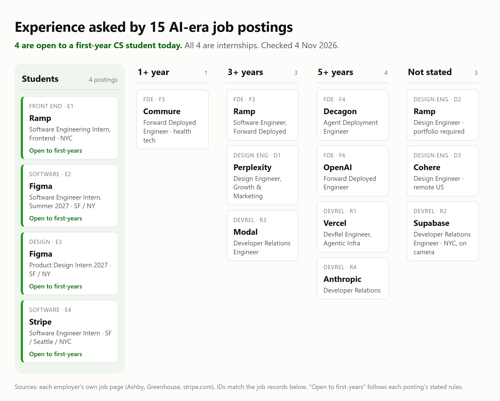

# Career Research: Forward Deployed Engineering and Two Alternatives

I'm a CS student who builds software for real clients and directs video on the side. This is my IS117 career research into which jobs want that mix, and what I'd still need to show them. It covers 15 job postings from 12 employers, each opened on the employer's own job page on 4 Nov 2026 and rechecked on 11 Nov 2026, with a [screenshot of every posting](https://github.com/mnguyenht/is117-career-research/tree/main/evidence).

**Finding:** All three role families hire people who ship working software for someone else, and most want to see that work before they read a resume. Only internships are open to a first-year today: 4 of the 15 postings. Forward deployed engineering fits the evidence I already have best. My clearest gap is proof that I can measure whether an AI feature works.

## At a glance

| | My answer |
| --- | --- |
| **Target, long term** | Forward Deployed Engineer: build and ship AI software inside a customer's organization |
| **Adjacent alternative** | Design Engineer: design and build product UI in one seat, from Figma to production code and design systems |
| **Entry options open now** | [Ramp Software Engineering Intern, Frontend](https://jobs.ashbyhq.com/ramp/a13ae586-f4cb-4385-8822-c42b9b54ed74) in New York, and [Figma Software Engineer Intern (Summer 2027)](https://job-boards.greenhouse.io/figma/jobs/6143238004) in San Francisco or New York |
| **Capability that repeats** | Scoping a customer's problem and delivering it end to end: all 4 FDE postings, 4 employers |
| **Gap to close first** | Evaluation: showing with tests and numbers that an AI feature works |
| **First portfolio pieces** | A written case study of a client site I built, then a reproducible benchmark of my open-source toolkit |

## Where I'm starting

**What I can show now** (from my resume, linked wherever there's something public to open):

- **Client build:** [CorporateConnections Hà Nội A](https://www.cchanoia.com/), a bilingual Next.js site I built in 2026 for one chapter of an international business networking group. Zoho CRM and Sanity CMS are wired in so the staff can update it without a developer. I worked with local staff and the group's international marketing team to clear the rights on every asset, and both teams approved the result.
- **AI tooling:** [bld-package](https://github.com/mnguyenht/bld-package), an open-source Claude Code skill set I built over summer 2026 (25 skills, per its README) for planning, design, security and deployment.
- **Applied AI:** Pushup Enforcer, a computer-vision fitness app I built as a course final project. It counts reps in real time, and if you miss your daily quota it emails your friends an embarrassing message an LLM wrote about you.
- **Mobile and design:** LinkUp, an Android app that helps college students find people free for a quick meetup, built with Expo and MapLibre for the Silicon Valley School of Design competition (2026), with trust-and-safety and privacy designed in ([submission video](https://drive.google.com/file/d/1mnC1yCjYFKKtYtU4N2Fh4lmu0Wa_6D2v/view)). Before that, [Ascent](https://github.com/mnguyenht/Ascent), a React Native music app I designed in Figma first (2023–24).
- **Brand and front end:** the [Standard Issue store](https://standard-issue-is117.vercel.app) and its [competitive research](https://github.com/mnguyenht/is117-tshirt-research) for this course; [ProdSystems](https://prodsystems.vercel.app/) ([code](https://github.com/mnguyenht/prodsystems)), a minimalist productivity toolkit in React, Tailwind and shadcn.
- **Work:** a paid React internship at Fabbi, a software outsourcing firm, mentored by professional developers (2025); a beta-testing and marketing internship at EUP, an ed-tech company (2024).
- **Content and directing:** a social media personality I run as a brand experiment; directing and editing sports videos for Blazio Sports, a youth sports-media social enterprise; audio/visual direction for [Tapyoca Tuesdays](https://www.instagram.com/tapyoca.official/), a live music night; public speaking, pitching and competitive debate.

**Constraints:** First-year CS student based near New York, the closest hub. I'm looking at summer 2027 internships; full-time postings here are long-term references. FDE postings list 40 to 50% travel, which I'd need to weigh later.

## Three role families

| Family | The work | Why I looked at it | Records |
| --- | --- | --- | --- |
| **Forward Deployed Engineer** | Embed with a customer, scope a vague problem, build and ship AI software, support adoption | The course's reference role, and my client build is a small version of it | F3 to F6 |
| **Design Engineer** | Design and build product UI in one seat, from Figma to production code and design systems | I design in Figma and build in React, and one posting names Claude Code outright | D1 to D3 |
| **Developer Relations** | Build with a product, then teach developers through demos, tutorials, talks and video | I make video and content, and bld-package already teaches other builders | R1 to R4 |
| **Entry paths** | Internships a first-year can apply to | Where I could start in summer 2027 | E1 to E4 |

## Job records

Each ID links to its screenshot. Pay is copied as posted (currency USD); senior ranges say nothing about entry pay. "Open to first-years" means the posting's own eligibility rules admit a first-year student.

### Forward Deployed Engineer

| ID | Employer and title | Where | Experience asked | Pay as posted | Open to first-years |
| --- | --- | --- | --- | --- | --- |
| [F3](evidence/f3-ramp.jpg) | [Ramp: Software Engineer, Forward Deployed, Enterprise Product](https://jobs.ashbyhq.com/ramp/09360e92-fc95-4ba6-9611-dfefd60b13ce) | New York HQ or San Francisco, hybrid | 3+ years preferred | $189K to $330K + equity | No |
| [F4](evidence/f4-decagon.jpg) | [Decagon: Agent Deployment Engineer](https://jobs.ashbyhq.com/decagon/230ad153-85be-4f7b-a368-5bad59e513e2) | New York City, on-site | 5+ years, technical and customer-facing | $175K to $230K + equity | No |
| [F5](evidence/f5-langchain.jpg) | [LangChain: Deployed Engineer (Early Career- SF)](https://jobs.ashbyhq.com/langchain/0f35c8e1-9318-411d-929b-04c60e6d8522) | San Francisco, on-site; 40% travel | 1 to 3 years | $160K to $185K OTE (base + variable) | No |
| [F6](evidence/f6-openai.jpg) | [OpenAI: Forward Deployed Engineer (FDE), SF](https://jobs.ashbyhq.com/openai/967f94aa-1706-4dba-ac89-bfbc2c38b688) | San Francisco, 3 office days; up to 50% travel | 5+ years | $185K to $300K + equity | No |

<b>F3 to F6: full records</b>

**F3 · Ramp · Software Engineer, Forward Deployed, Enterprise Product.** Posted 22 Oct 2026. Fintech.
- Work: deliver software end to end for Ramp's largest customers; scope product specs and build agents that carry them out; work with sales, solutions, customer success and account teams to close deals and activate customers; embed in one product area and decide when to build custom and when to push a broader project.
- Required: extensive experience building with and for agents; shipping at scale; comfort facing customers. Preferred: 3+ years of software engineering.
- Work samples: none stated.
- Re-listed: the link I saved on 4 Nov showed "Job not found" by 11 Nov; Ramp re-posted the role under this title with the same posted date.

**F4 · Decagon · Agent Deployment Engineer.** Posted 13 May 2026. Customer support AI.
- Work: own architecture and delivery of AI agents for enterprise customers, from scoping through evaluation to production; design agent logic and guardrails; build integrations with customer CRMs, ticketing systems and data pipelines; debug model failures from traces; build evaluation and regression tests.
- Required: 5+ years in a technical customer-facing role; strong coding and API skills. Preferred: LLM or agent work, enterprise SaaS integrations.

**F5 · LangChain · Deployed Engineer (Early Career).** Posted 7 Oct 2026. AI agent tooling.
- Work: co-build production AI agents with customers' engineering teams; win pre-sales by designing proofs of concept; help customers deploy and run agent apps, and advise them after the sale; run demos, trainings and workshops; turn field lessons into reusable patterns and example code. 40% travel to customer sites.
- Required: 1 to 3 years in software, customer or solutions engineering or a similar technical role; strong Python, JavaScript and systems fundamentals; hands-on experience building and deploying agent or LLM apps beyond simple API calls; clear technical communication. Preferred: agents in production (LangChain, LangGraph or similar); LLM evaluation, observability or guardrails; cloud and containers.
- Work samples: none stated.
- The lowest experience bar among the FDE postings and the only one aimed at early-career engineers. Its Python and JavaScript stack matches mine.
- Replaces Commure's FDE posting (F5 until 11 Nov 2026), which was taken down; Commure now lists only a Senior FDE asking 4+ years.

**F6 · OpenAI · Forward Deployed Engineer (FDE), SF.** Posted 11 Sep 2026. Same title as the course guide's J1.
- Work: lead deployments of frontier models from discovery to production; own delivery across several deployments; build full-stack systems; turn repeated patterns into tools or playbooks; send field feedback to research and product. Success is measured by adoption, workflow impact and eval-driven feedback.
- Required: 5+ years of engineering or deployment work including customer-facing; production Python or JavaScript on front end and back end; experience with LLM systems.

### Design Engineer

| ID | Employer and title | Where | Experience asked | Pay as posted | Open to first-years |
| --- | --- | --- | --- | --- | --- |
| [D1](evidence/d1-perplexity.jpg) | [Perplexity: Design Engineer, Growth & Marketing](https://jobs.ashbyhq.com/perplexity/fbbd496b-1d14-4396-b31d-38fbea0dc666) | San Francisco or New York City | 3+ years | $180K to $300K + equity | No |
| [D2](evidence/d2-ramp.jpg) | [Ramp: Design Engineer](https://jobs.ashbyhq.com/ramp/b68aca53-16c0-4ced-ab1d-e8beb2940b4f) | New York HQ, hybrid | Not stated | $172K to $440K + equity | No |
| [D3](evidence/d3-cohere.jpg) | [Cohere: Design Engineer](https://jobs.ashbyhq.com/cohere/75765a04-82cb-4d17-ac53-09b156656a7d) | United States, remote | 6+ years | $180K to $245K + equity | No |

<b>D1 to D3: full records</b>

**D1 · Perplexity · Design Engineer, Growth & Marketing.** Posted 27 Jul 2026.
- Work: ship launch and marketing pages from Figma to production; build interactive pieces with brand designers; keep the design system and component library in sync with Figma; run A/B tests; model CMS schemas while moving content from Framer to Sanity.
- Required: React, TypeScript, Tailwind and CSS; design-to-code work; **a portfolio site** showing marketing-site and design work.
- Preferred: A/B testing, SEO, web animation (GSAP, Motion), 3D, headless CMS, AI-assisted workflows.
- Note: I've already shipped a Sanity CMS integration for a client.

**D2 · Ramp · Design Engineer.** Posted 8 Jul 2026. Hiring several.
- Work: design and build product surfaces end to end; work AI-first with LLMs, Cursor and Claude Code; prototype in React and test ideas with customers; extend the design system; design patterns that show what AI agents are doing for a customer.
- Required: React, TypeScript, semantic HTML, modern CSS; active use of Cursor and Claude Code; **a portfolio showing visual and interaction craft** in live work or prototypes; based in or moving to New York.
- Preferred: design-system contributions, experimentation, design tokens, fintech or B2B background.

**D3 · Cohere · Design Engineer.** Posted 9 Oct 2026. Enterprise AI.
- Work: own the Figma component library for Cohere's design system; build its components in production; keep design tokens in sync between Figma and code (CSS variables, Tailwind config); build Figma-to-code tooling and docs; make the system readable by AI models.
- Required: 6+ years of design and/or engineering experience, with depth in both.
- Preferred: Figma plugins, token pipelines, MCP workflows, WCAG, npm packaging.
- Work samples: none stated.

### Developer Relations

| ID | Employer and title | Where | Experience asked | Pay as posted | Open to first-years |
| --- | --- | --- | --- | --- | --- |
| [R1](evidence/r1-vercel.jpg) | [Vercel: DevRel Engineer, Agentic Infrastructure](https://job-boards.greenhouse.io/vercel/jobs/6122437004) | Hybrid: San Francisco, New York, Austin | 5+ years | $168,000 to $252,000 base (SF) | No |
| [R2](evidence/r2-supabase.jpg) | [Supabase: Developer Relations Engineer (New York)](https://jobs.ashbyhq.com/supabase/98ae5c78-eab7-4879-b143-96b98e4d0dbb) | Remote, must live in New York | Not stated | Not listed | No |
| [R3](evidence/r3-modal.jpg) | [Modal: Developer Relations Engineer](https://jobs.ashbyhq.com/modal/546c9eb1-aaf7-47ba-8e9d-0bcd443b3e94) | San Francisco, New York or Stockholm, on-site | 3+ years as a software engineer | $175K to $275K + equity | No |
| [R4](evidence/r4-anthropic.jpg) | [Anthropic: Developer Relations](https://job-boards.greenhouse.io/anthropic/jobs/5383596008) | San Francisco or New York | 5+ years | $290,000 to $435,000 | No |

<b>R1 to R4: full records</b>

**R1 · Vercel · DevRel Engineer, Agentic Infrastructure.** Updated 7 Nov 2026.
- Work: build agents and apps on Vercel's AI products before launch; turn them into demos, templates and open-source projects; teach through writing, talks, video and live coding; feed rough edges back to product.
- Required: shipped AI apps or agents; TypeScript, Next.js and the AI SDK; a public body of work; fast demo building.
- Work samples: **required.** Applicants must link something they made that taught developers (a talk, repo, post or video). Applications without one are not considered.

**R2 · Supabase · Developer Relations Engineer (New York).** Posted 21 Aug 2026. Database platform.
- Work: publish technical content, mostly video; build demos and tutorials with Next.js, React and Stripe; speak at meetups and livestream builds; support the community on Discord, X and YouTube; pass developer feedback to the team.
- Required: JavaScript or TypeScript, Postgres, a modern front-end framework; written or video technical content; comfort on camera and on stage.
- Preferred: a growing audience on YouTube, Twitch or X; open source; using Supabase.
- Must be based in New York for video shoots and local events. The only DevRel posting here with no years stated.

**R3 · Modal · Developer Relations Engineer.** Posted Sep 2025, edited since (mentions an Oct 2026 funding round). AI infrastructure.
- Work: create practical content on new AI tech; demo and speak at developer events; work with users online and in person; build integrations and joint marketing with other developer companies; track impact with the go-to-market team.
- Required: 3+ years as a software engineer; love of teaching; technical communication. Preferred: an existing developer following.

**R4 · Anthropic · Developer Relations.** Updated 21 Aug 2026. Long-term reference.
- Work: grow developer adoption of Claude Code; write sample apps, tutorials and integration guides; run workshops and events; define how developer success is measured; carry feedback to product.
- Required: 5+ years in DevRel or developer experience; a record of growing a developer ecosystem; production-quality demos. Preferred: conference speaking, technical writing or video.

### Entry paths for summer 2027: stepping stones toward FDE

| ID | Employer and title | Where | Eligibility | Pay as posted | Open to first-years |
| --- | --- | --- | --- | --- | --- |
| [E1](evidence/e1-ramp.jpg) | [Ramp: Software Engineering Intern, Frontend](https://jobs.ashbyhq.com/ramp/a13ae586-f4cb-4385-8822-c42b9b54ed74) | New York HQ, hybrid | Pursuing a BS, graduating Dec 2027 or later | $12,500/month + housing stipend | **Yes** |
| [E2](evidence/e2-figma.jpg) | [Figma: Software Engineer Intern (Summer 2027)](https://job-boards.greenhouse.io/figma/jobs/6143238004) | San Francisco or New York hub | No graduation window stated | $55/hour + housing stipend | **Yes** |
| [E3](evidence/e3-figma.jpg) | [Figma: Product Design Intern (2027)](https://job-boards.greenhouse.io/figma/jobs/6180005004) | San Francisco or New York hub | No graduation window stated | $46/hour + housing stipend | **Yes** |
| [E4](evidence/e4-stripe.jpg) | [Stripe: Software Engineer, Intern (Summer or Winter)](https://stripe.com/careers/listing/software-engineer-intern-summer-or-winter/8128745) | San Francisco, Seattle, New York | One year of university preferred | $123,500/year base, annualized | **Yes** |

<b>E1 to E4: full records</b>

**E1 · Ramp · Software Engineering Intern, Frontend.** Posted 24 Sep 2026.
- Work: build interfaces for businesses with complex needs; own projects with product, design and business teams; turn customer feedback into product changes. Stack: TypeScript, React, Vite and Ramp's own design system.
- Required: strong JavaScript and attention to visual and product detail; a record of shipping products, features or side projects. Nice to have: React, TypeScript, interest in fintech or AI.

**E2 · Figma · Software Engineer Intern (Summer 2027).** Updated 27 Oct 2026.
- Work: join an engineering team; break features down and plan; build, test and document; take part in code review; ship a project by the end.
- Wanted: clean code in one general-purpose language and core CS (data structures, algorithms); problems solved through school, work or projects. A plus: AI-assisted coding tools such as Copilot, ChatGPT or Claude.

**E3 · Figma · Product Design Intern (2027).** Updated 27 Oct 2026.
- Work: own features from idea to shipped design; work with product, research and marketing.
- Wanted: a baseline in visual or interaction design; shipped projects; ideas expressed through prototypes and code. A plus: design systems and systems thinking. The posting links Figma's own guides to building a design portfolio.

**E4 · Stripe · Software Engineer, Intern.** Updated 29 Oct 2026.
- Work: write production software as a full team member; give and receive code review; build with AI tooling.
- Required: CS fundamentals; programming through side projects or classwork; multi-person projects or open source; using AI tools while reviewing and checking what they produce. Preferred: one year of university.

## What repeats

**Every family hires someone who ships for another person and can show it.** Counts are distinct employers, from the role text of each posting.

| Capability | Records | Employers | What it means for me |
| --- | --- | --- | --- |
| Scope a customer's problem, deliver it end to end | F3 to F6 | 4 | The core FDE skill. My client build is the closest evidence I have, and it isn't written up yet. |
| Build with LLMs or agents | F3 to F6, D2, D3, R1, R3, R4 | 8 | Shows up in all three families. My AI work so far is a toolkit for builders and one course project. |
| Build demos or prototypes | F5, F6, D2, R1 to R4, E2, E3 | 8 | A working demo with a walkthrough is the common currency. Video is a strength I can use here. |
| Show public work before the interview | Required: D1, D2, R1. Preferred: R2, R3 | 5 | Design engineering and DevRel screen on it. I have repos and live sites but no single page tying them together. |
| Use AI coding tools with judgment | D1, D2, E2, E4 | 4 | Stripe asks interns to check and correct what AI tools produce. My case studies need an AI-use section that shows this. |
| Evaluate AI output with tests | F4, F6; a plus in F5 | 2 | Required only in senior FDE postings, and even the early-career one (F5) lists it as a plus. It is exactly what a reviewer would ask about my toolkit's savings claims. |
| Own a design system, Figma to code | D1, D2, D3 | 3 | The design engineer signature. I've used design systems but haven't contributed to one. |

## Compare and choose

| | Forward Deployed Engineer | Design Engineer | Developer Relations |
| --- | --- | --- | --- |
| Industries in my sample | Fintech, agent tooling, support AI, frontier AI | AI search, fintech, enterprise AI | Developer platforms, AI infrastructure, frontier AI |
| Experience asked | 1 to 5+ years | 3 to 6+ years, or not stated (D2); portfolio required | 3 to 5+ years, or not stated (R2) |
| Location and travel | NYC, SF; 40 to 50% travel in 2 postings | NYC, SF, remote | NYC, SF; on camera and at events |
| Evidence I have | Client build with CRM and CMS, applied-AI project, open-source toolkit | Figma plus React work, Standard Issue store, a design-competition app | Toolkit that teaches builders, video directing, content brand experiment, pitching |
| Biggest gap | Evaluation; integration depth beyond a landing page | A portfolio site with interaction craft | Developer-facing teaching: a tutorial, a talk or a demo repo |
| Open to first-years now | No FDE internship in this sample; E1 is a front-end route in | Through E1 (front end) or E3 (design) | No DevRel internship found |

**Why FDE first:** its core task, scoping a customer's problem and shipping it end to end, is the one I've already done for a real client. No FDE posting in this sample is open to a first-year, so I'd start through a software internship (E1 or E2). Design engineering is my second choice: I already design in Figma and build in React, but it screens on a portfolio of interaction craft that I'd have to build first. DevRel uses my most unusual strengths, video and an audience, but every DevRel posting I found is full-time and three of four ask for 3 or more years.

## My provisional target

> I am exploring **forward deployed engineering** for organizations that run on customer data and content, starting with bilingual clients like the one I've already built for. Records F3 to F6 repeatedly ask for scoping a customer's problem and shipping it end to end, and all four name LLMs or agents. I'm drawn to it because my best work so far was built for someone else to run without me: a client site whose staff edit it through a CMS, and a toolkit other builders install. I can already show a client build, an applied-AI course project and an open-source AI toolkit. My next project will test whether I enjoy measuring software as much as shipping it, and give me evidence for evaluation. My near-term entry options are Ramp's frontend internship (E1) and Figma's software engineering internship (E2), both open to first-years.

**Alternative:** Design Engineer, my second choice. Ramp's frontend internship (E1) is interface work, so it adds evidence for this path too. The gap is a portfolio that shows interaction craft, which D1 and D2 require.

## Skills to evidence

| Employer need | Records | What I can show now | Gap | Artifact to build | How a reviewer checks it |
| --- | --- | --- | --- | --- | --- |
| Scope a customer's problem | F3 to F6 | The networking-group site: two teams with different needs, asset rights cleared, both approved | Decisions aren't written down anywhere | Case study: problem, constraints, alternatives, what I built, what I'd change | Read it alongside screenshots of the shipped site |
| Integrate with customer systems | F4 | Zoho CRM and Sanity CMS on the same build | One integration, front-end side only | A data-flow diagram inside the case study | Diagram, plus code excerpts (the client repo stays private) |
| Evaluate AI output | F4, F6; F5 as a plus | Nothing yet. bld-package's README claims "up to 80%" less context and "up to 75%" fewer tokens, with no published method | This is the gap | Benchmark repo: the same tasks run with and without bld-package, tokens logged, method and raw results public | Re-run the script and compare with the published logs |
| Build with LLMs or agents for a user | F3 to F6, D2, R1 | bld-package (for builders); the fitness app (LLM-written messages) | Nothing built for a non-technical user's task | Later: a small agent workflow for a real campus organization, with a rule-based baseline and a human review step | Demo, repo and test results against the baseline |
| Demo and explain | F5, F6, R1 to R4 | The fitness app's demo video and spec; film and editing work | No developer-facing demo | A 3-minute walkthrough of the benchmark | Watch it |
| Public work, one place | D1, D2, R1, R2, R3 | GitHub repos, live sites | No portfolio page with a stated target | Portfolio page: target at the top, the two case studies first | A classmate finds my target and strongest proof in under a minute |
| Use AI tools with judgment | D1, D2, E2, E4 | Built most projects with Claude Code | The judgment isn't visible | An AI-use section in every case study: what the AI did, what I checked and fixed | Read it |

## Portfolio references

Checked 4 Nov 2026. A polished portfolio doesn't prove its owner was hired because of it.

| Who and role | What counts as proof | Speed to proof | What I'd adapt | What I'd avoid |
| --- | --- | --- | --- | --- |
| [Emil Kowalski](https://emilkowal.ski), design engineer (formerly Linear and Vercel) | Open-source components other developers use ([Sonner](https://sonner.emilkowal.ski/), [Vaul](https://vaul.emilkowal.ski/)), plus essays on how he built them | One click from the home page | Ship one thing other people use, then explain how it was made | Nothing major; the format suits a design engineer more than an FDE |
| [Rauno Freiberg](https://rauno.me/craft), interaction designer at Vercel | About 75 to 80 small prototypes on one Craft page, each dated and linked | Two clicks | A dated log of small experiments shows steady practice | Most entries show what, not why, so a reviewer can't see the decisions |
| [Lee Robinson](https://leerob.com), engineer and writer (formerly Vercel, then Cursor) | Dated posts and topic notes on DevRel, docs and AI | One click | Teaching through writing, dated so a reader sees consistency | No demos or code on the home page |
| [Amandeep Mander](https://amandeep-mander.pages.dev/), self-described AI engineer and consultant | Case studies with Buyer, Business problem, Solution pattern, Evidence and Outcome fields; one live app | One click to the live app | Those case-study fields map almost one to one onto an FDE job | Outcomes with no numbers or baseline, and claims ("10+ years") with nothing to check them against |

**What I take from this:** Mander's case-study fields for structure, Emil's "ship it, then explain it" for proof. The warning applies to me too: my toolkit's savings claims have no published method yet, which is why the benchmark comes first.

## Plan

Proposed dates; the course's deadlines override them.

| Stage | Action | Artifact | Check | By |
| --- | --- | --- | --- | --- |
| Research | Verify job records, choose a provisional target | This repo | Peer review in class | 5 Nov |
| Build | Write the client-site case study | Case-study page | A classmate can name the problem, my role and the result | 15 Nov |
| Build | Benchmark bld-package on a fixed task set | Public repo with method and raw logs | Someone else re-runs it and gets similar numbers | 6 Dec |
| Check | Correct bld-package's README claims to the measured numbers | README update | Every number links to the benchmark | 6 Dec |
| Present | Portfolio page with my target and both case studies | Live page | A peer finds my target and strongest proof in under a minute | 13 Dec |

**If it's too big:** benchmark one skill on three tasks instead of the whole set. **Timing note:** the summer 2027 internships above were posted between March and October 2026 and are open now. Applying is a separate decision and not part of this research.

## My unresolved question

Does freelance client work like my networking-group site count as the customer-facing experience FDE internships look for, or do reviewers want to see it inside a company?

## Peer review and revisions

Classmates review this research by [opening an issue](https://github.com/mnguyenht/is117-career-research/issues/new?template=peer-review.md): one observation, why it matters and a suggested next step. I answer each issue in its thread with a decision (implement, investigate, defer or decline) and the reason. An accepted change lands in a commit that names the issue number; the issue then links that commit and says how the change was checked, and the reviewer re-checks it before it closes. Unfinished work stays open with a next step.

**Status, 11 Nov 2026:** 3 peer issues open ([see issues](https://github.com/mnguyenht/is117-career-research/issues)).

## Method, AI use and limits

- **How:** Claude Code (an AI assistant) ran two research subagents that found postings through each employer's public job data (Greenhouse, Lever and Ashby). Claude then re-fetched every posting from the employer's own source and checked the subagents' notes against it. On 11 Nov 2026 Claude rechecked every posting through each job board's public data: 13 were still open (small updates are recorded above), and two FDE postings had closed, so F3 now points to Ramp's re-listing and F5 to a LangChain posting. Headless Chromium (Playwright 1.64) saved a full-page screenshot of each posting. Nothing was applied to, no accounts were created and no one was contacted.
- **What the AI did:** found the postings, summarized them in its own words, counted repeated capabilities, drafted the comparison, the target statement and the plan, and made the figure.
- **What I provided:** the course guide and my CV with its project links. I chose the target: FDE first, design engineering second.
- **Limits:** 15 postings from 12 employers describe this sample, not the job market. Palantir postings were left out on purpose: I chose not to consider the company because of the work it does. Capability counts come from keyword matches in each posting's role text, then read by hand; a posting can need a skill it doesn't name. "Open to first-years" reflects each posting's stated rules, not a personal eligibility check. Pay figures are what each posting lists, not offers. Personal contact details are left out on purpose. Screenshots of job pages are kept for study and commentary.

## Sources

All opened 4 Nov 2026 and rechecked 11 Nov 2026 on the employer's own job page. Screenshots are in [evidence/](https://github.com/mnguyenht/is117-career-research/tree/main/evidence).

- **FDE:** [F3 Ramp](https://jobs.ashbyhq.com/ramp/09360e92-fc95-4ba6-9611-dfefd60b13ce), [F4 Decagon](https://jobs.ashbyhq.com/decagon/230ad153-85be-4f7b-a368-5bad59e513e2), [F5 LangChain](https://jobs.ashbyhq.com/langchain/0f35c8e1-9318-411d-929b-04c60e6d8522), [F6 OpenAI](https://jobs.ashbyhq.com/openai/967f94aa-1706-4dba-ac89-bfbc2c38b688)
- **Design Engineer:** [D1 Perplexity](https://jobs.ashbyhq.com/perplexity/fbbd496b-1d14-4396-b31d-38fbea0dc666), [D2 Ramp](https://jobs.ashbyhq.com/ramp/b68aca53-16c0-4ced-ab1d-e8beb2940b4f), [D3 Cohere](https://jobs.ashbyhq.com/cohere/75765a04-82cb-4d17-ac53-09b156656a7d)
- **Developer Relations:** [R1 Vercel](https://job-boards.greenhouse.io/vercel/jobs/6122437004), [R2 Supabase](https://jobs.ashbyhq.com/supabase/98ae5c78-eab7-4879-b143-96b98e4d0dbb), [R3 Modal](https://jobs.ashbyhq.com/modal/546c9eb1-aaf7-47ba-8e9d-0bcd443b3e94), [R4 Anthropic](https://job-boards.greenhouse.io/anthropic/jobs/5383596008)
- **Entry paths:** [E1 Ramp](https://jobs.ashbyhq.com/ramp/a13ae586-f4cb-4385-8822-c42b9b54ed74), [E2 Figma](https://job-boards.greenhouse.io/figma/jobs/6143238004), [E3 Figma](https://job-boards.greenhouse.io/figma/jobs/6180005004), [E4 Stripe](https://stripe.com/careers/listing/software-engineer-intern-summer-or-winter/8128745)
- **Portfolios:** [emilkowal.ski](https://emilkowal.ski), [rauno.me/craft](https://rauno.me/craft), [leerob.com](https://leerob.com), [amandeep-mander.pages.dev](https://amandeep-mander.pages.dev/)
- **Checked and set aside:**
  - [Databricks AI Engineer, Forward Deployed Engineering](https://databricks.com/company/careers/open-positions/job?gh_jid=8546367002): states it is not for interns, new graduates or entry-level applicants.
  - [Decagon Engineering Intern (Summer 2027)](https://jobs.ashbyhq.com/decagon/16529089-a048-4bc3-8456-3f197135e00b) and [Vercel Software Engineering Intern](https://job-boards.greenhouse.io/vercel/jobs/6181759004): both limited to 2027 and 2028 graduates.
  - Google's STEP internship for first- and second-years: no 2027 posting found on Google's own site; aggregator listings conflict.
  - Hebbia, Glean, Anduril and Rippling: no job board found at the expected addresses. Granola and Lovable design engineer roles: London only.
- **Course:** IS117 "Career Research to Portfolio Plan" guide (course handout). Companion work: [Standard Issue store](https://standard-issue-is117.vercel.app), [T-shirt research](https://github.com/mnguyenht/is117-tshirt-research).
